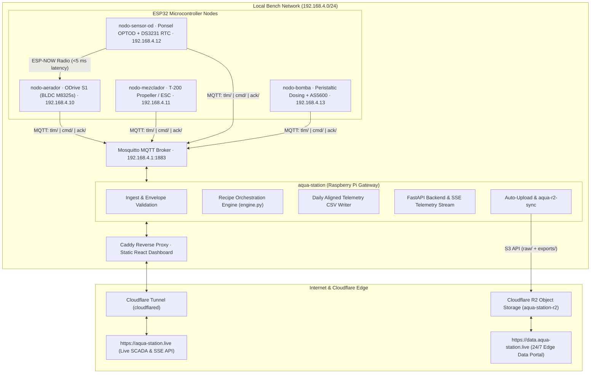

# AGENTS.md — AquaControl Developer & Agent Instructions

This document provides architectural context, development conventions, hardware safety invariants, and testing procedures for human engineers and AI coding agents operating on the **AquaControl** codebase.

---

## 1. System Architecture Overview

AquaControl is a distributed cyber-physical system for automated clean-water reaeration testing (ASCE/EWRI 2-22), dissolved oxygen (DO) control, and mass-transfer ($K_L a$) characterization.



### Component Roles & Directory Layout
| Directory | Role | Hardware / Framework | Key Responsibility |
|---|---|---|---|
| `nodo-aerador/` | `aerator` | ESP32-S3 + ODrive S1 UART | Mechanical aeration, closed-loop DO control (Fuzzy/PID at 20 Hz). |
| `nodo-sensor-od/` | `od_sensor` | ESP32 + Modbus RTU RS485 | Optical DO sensing (Aqualabo OPTOD), RTC DS3231 timestamping, ESP-NOW broadcast. |
| `nodo-bomba/` | `pump` | ESP32 + DRV8871 + AS5600 | Peristaltic volumetric dosing of $Na_2SO_3$ for chemical deoxygenation. |
| `nodo-mezclador/` | `mixer` | ESP32-S3 + T-200 / SNR8503 | Hydrodynamic mixing ($\sim 1000\text{--}1200\text{ RPM}$) to prevent stratification and maintain probe flow. |
| `aqua-station/` | Gateway | Raspberry Pi 4 / Linux | Mosquitto broker, FastAPI backend, recipe orchestrator, SQLite/PostgreSQL, React UI, Cloudflare Tunnel & R2 sync. |
| `control-notes/` | Research | Markdown docs | Mathematical modeling, clean-water constraints, and academic control theory. |
| `scripts/` | Tooling | Python / MATLAB | System identification, calibration, and telemetry analysis. |

---

## 2. Invariants and Safety Constraints

When modifying code or creating new features, agents **MUST** obey these invariants:

### 2.1 Clean-Water Bench DO Physics ($R_{bio} = 0$)
- In clean water without biomass, biological oxygen consumption is zero.
- Reaeration is strictly positive ($dC/dt > 0$) while $C < C^*$. The aerator motor cannot extract dissolved oxygen ($u \ge 0$).
- **Zero Overshoot Imperative ($M_p = 0.0\%$):** Any overshoot past the setpoint is an irreversible test failure requiring re-scrubbing with sodium sulfite.
- **Micro-bubble Hold-up & Sensor Lag:** The OPTOD optical membrane has a time lag ($\tau_s \approx 20\text{ s}$), and micro-bubbles hold latent oxygen for $15\text{--}30\text{ s}$. The controller must brake **before** $C(t)$ reaches the setpoint.

### 2.2 Motor & Actuator Physical Limits
- **ODrive S1 Aerator:**
  - Velocity is strictly capped at **600 RPM** (`MAX_MOTOR_RPM = 600.0f`).
  - Discard UART velocity noise spikes $> 650\text{ RPM}$.
  - State 8 = `CLOSED_LOOP_CONTROL` (Armed); State 1 = `IDLE` (Disarmed).
- **Peristaltic Pump:**
  - Pure PI speed control (derivative action is forbidden to avoid chattering from AS5600 discrete ticks).
  - Volumetric dosing runs at 100 Hz on Core 1 with H-bridge suck-back compensation.

### 2.3 Dual-Core FreeRTOS Discipline
- **Core 1 (Deterministic Control Loop):** Owns hardware buses (UART/LEDC/I2C). Never execute blocking network requests, file logging, or allocations on Core 1.
- **Core 0 (Cloud Worker):** Handles WiFi, MQTT publish/subscribe, and flash operations.
- Inter-core communication **MUST** use spinlocks (`portENTER_CRITICAL(&_mux)` / `portEXIT_CRITICAL(&_mux)`).

---

## 3. How to Incorporate and Validate a Controller

For detailed mathematical derivations and C++ code examples, consult [`docs/HOW_TO_INCORPORATE_A_CONTROLLER.md`](file:///root/aqua/docs/HOW_TO_INCORPORATE_A_CONTROLLER.md).

### Summary Workflow:
1. **Design Isolated C++ Class:** Implement your control law with explicit time delta `dt`.
2. **Apply DO Safeguards:**
   - Use setpoint weighting ($b \in [0.2, 0.5]$) or setpoint ramp profiles.
   - Clamp integration outside the linear band ($|e| > 0.8\text{ mg/L}$).
   - Implement predictive coasting cutoff ($C_{\text{pred}} = C_{\text{meas}} + \tau_{\text{lag}} \frac{dC}{dt}$).
3. **Run SIL Unit Tests:** Compile with standard host tools (`g++`) and execute test suites in `nodo-aerador/test/`.
4. **Validate against Virtual Bus:** Build the `-virtual` environment (`-D<NODE>_VIRTUAL=1`) to confirm MQTT command handling and dashboard integration before deploying to physical hardware.
5. **Orchestrate via Recipes:** Add or configure phases in `aqua-station/gateway/aqua_gateway/orchestration/recipes.py` (e.g. `_CLOSED_LOOP`).

---

## 4. Build and Test Commands

### Firmware (PlatformIO)
```bash
# Real hardware builds
pio run -d nodo-aerador -e esp32-s3
pio run -d nodo-bomba -e esp32dev
pio run -d nodo-mezclador -e esp32-s3
pio run -d nodo-sensor-od -e lora32

# Virtual hardware builds (software simulation)
pio run -d nodo-aerador -e esp32-s3-virtual
pio run -d nodo-bomba -e esp32dev-virtual
pio run -d nodo-mezclador -e esp32-s3-virtual
pio run -d nodo-sensor-od -e virtual-s3
```

### Gateway & Backend Tests
```bash
cd /root/aqua/aqua-station/gateway
pytest
```

### Virtual Node End-to-End Checks
```bash
cd /root/aqua/aqua-station/firmware/virtual_node
python3 check_closed_loop.py
python3 check_setpoints.py
```

