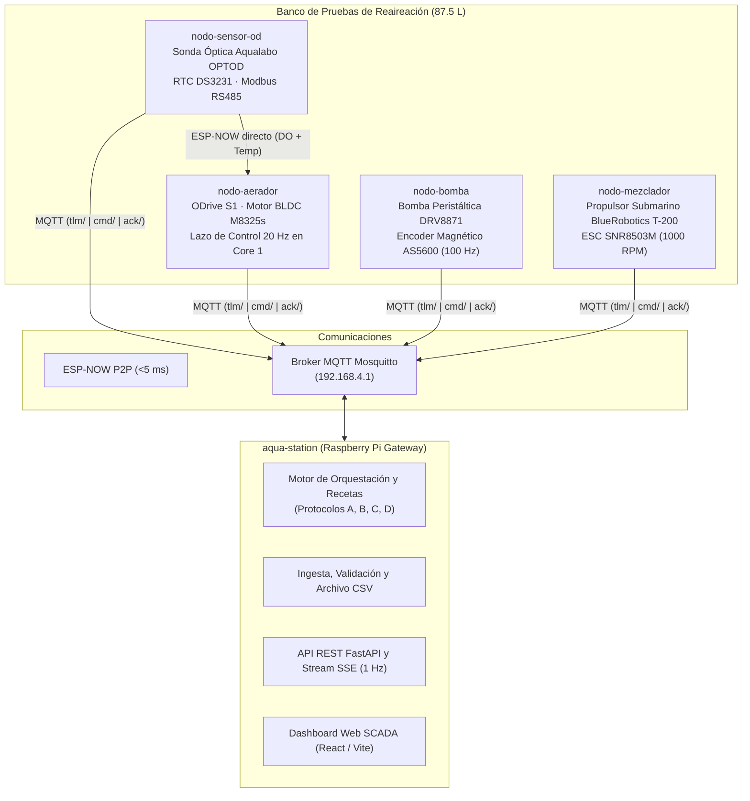

# AquaControl: Plataforma Distribuida de Control y SCADA para Dinámica de Oxígeno Disuelto

[](https://platformio.org/)
[](https://fastapi.tiangolo.com/)
[](https://vitejs.dev/)
[](https://mosquitto.org/)

**AquaControl** es un sistema ciberfísico distribuido diseñado para la automatización, monitoreo SCADA en tiempo real y control en lazo cerrado de reactores de aireación de agua limpia, cumpliendo con el estándar internacional **ASCE/EWRI 2-22** (*Measurement of Oxygen Transfer in Clean Water*).

---

## 1. Arquitectura del Sistema

El sistema coordina cuatro microcontroladores ESP32 independientes, una estación central (Raspberry Pi 4) y una interfaz web reactiva:



---

## 2. Componentes del Repositorio

| Directorio | Descripción |
|---|---|
| [`nodo-aerador/`](nodo-aerador/) | Firmware del actuador de aireación mecánica. Ejecuta el lazo cerrado determinista a 20 Hz sobre el ODrive S1 y recibe lecturas por ESP-NOW. |
| [`nodo-sensor-od/`](nodo-sensor-od/) | Firmware de adquisición de Oxígeno Disuelto. Lee la sonda óptica Ponsel OPTOD vía Modbus RTU, sincroniza tiempo con DS3231 y transmite por ESP-NOW y MQTT. |
| [`nodo-bomba/`](nodo-bomba/) | Firmware de desoxigenación química. Controla la bomba peristáltica para inyección volumétrica exacta de $Na_2SO_3$ con encoder AS5600 a 100 Hz. |
| [`nodo-mezclador/`](nodo-mezclador/) | Firmware de agitación hidrodinámica con propulsor T-200 para prevenir estratificación y mantener flujo laminar sobre la membrana sensora. |
| [`aqua-station/`](aqua-station/) | Gateway central y SCADA. Contiene el backend en FastAPI, el motor de orquestación de protocolos (`recipes.py`), el broker Mosquitto y el frontend en React. |
| [`control-notes/`](control-notes/) | Documentación técnica profunda sobre dinámica de transporte de masa, irreversibilidad en agua limpia y benchmarks industriales. |
| [`scripts/`](scripts/) | Scripts de identificación de sistemas (SysID), calibración de flujo y generación de perfiles de control. |
| [`docs/`](docs/) | Guías de integración de controladores, arquitectura y planes de prueba. |

---

## 3. Cómo Incorporar un Controlador al Sistema

Para incorporar cualquier tipo de algoritmo de control (PID, Lógica Difusa, MPC, Control por Modos Deslizantes, etc.) al lazo de Oxígeno Disuelto, siga la metodología descrita en detalle en [`docs/HOW_TO_INCORPORATE_A_CONTROLLER.md`](docs/HOW_TO_INCORPORATE_A_CONTROLLER.md):

### 3.1 Restricciones Críticas del Proceso
- **Dinámica Asimétrica e Irreversible ($R_{bio} = 0$):** En agua limpia no hay consumo biológico pasivo. El motor a 0 RPM no puede extraer oxígeno. **Cualquier sobreimpulso ($M_p > 0\%$) arruina el ensayo**, requiriendo desoxigenación química total.
- **Anti-Windup Obligatorio:** Todo integrador debe congelarse fuera de una banda estrecha ($|e| \le 0.8\text{ mg/L}$) y descargarse inmediatamente si $e < 0$.
- **Frenado Predictivo:** Compensar los retardos de transporte de la sonda ($T_{90} \approx 30\text{--}60\text{ s}$) y de flotabilidad de microburbujas ($\tau_{\text{bubble}} \approx 20\text{ s}$) cortando potencia antes del cruce por consigna:
  $$C_{\text{pred}}(t) = C_{\text{meas}}(t) + (\tau_s + \tau_{\text{bubble}}) \cdot \frac{dC_{\text{meas}}}{dt}$$

### 3.2 Pasos de Integración
1. **Aislamiento en Firmware:** Implementar el algoritmo en C++ desacoplado del hardware dentro de [`nodo-aerador/src/control_engine.cpp`](nodo-aerador/src/control_engine.cpp).
2. **Pruebas SIL (Software-in-the-Loop):** Ejecutar pruebas unitarias nativas en PC usando el arnés de prueba en [`nodo-aerador/test/test_control_engine.cpp`](nodo-aerador/test/test_control_engine.cpp).
3. **Validación en Bus Virtual:** Compilar el firmware con el bus simulado (`-D<NODE>_VIRTUAL=1`) y validar la integración con el gateway sin riesgo de dañar actuadores físicos.
4. **Orquestación en Recetas:** Declarar el protocolo de lazo cerrado en [`aqua-station/gateway/aqua_gateway/orchestration/recipes.py`](aqua-station/gateway/aqua_gateway/orchestration/recipes.py) vinculando los comandos MQTT `set_mode` y `set_config`.
5. **Validación Experimental:** Ejecutar el ensayo desde el dashboard SCADA y evaluar las métricas en el archivo de telemetría exportado (`/data/telemetry/EXP_03_PID_LOOP.CSV`).

---

## 4. Guías para Desarrolladores y Agentes de IA

Si está colaborando en este proyecto como ingeniero o agente de IA, consulte:
- [`AGENTS.md`](AGENTS.md): Reglas de arquitectura, invariantes de seguridad de hardware, separación entre cores de FreeRTOS y comandos de build/test.
- [`.agents/rules/`](.agents/rules/): Reglas específicas sobre límites de velocidad de ODrive, despliegue de red y consideraciones de telemetría.
- [`VIRTUAL_NODES.md`](VIRTUAL_NODES.md): Convenciones y uso de nodos virtuales para desarrollo sin hardware.

---

## 5. Lanzador Unificado y Comandos Rápidos

El proyecto incluye la herramienta CLI unificada [`aqua.py`](aqua.py) en la raíz del repositorio:

```bash
# Estado general del banco y mapeo de entornos
./aqua.py status

# Ejecutar el stack de desarrollo local completo (Broker, BD, Gateway, Virtual Nodes y Web UI)
./aqua.py dev

# Lanzar el puente de nodos virtuales (simula los 4 ESP32 contra un broker MQTT)
./aqua.py virtual --hz 5

# Ejecutar las suites de pruebas (390 pruebas de gateway y validaciones en bucle cerrado)
./aqua.py test
./aqua.py test --gateway

# Compilación de firmware vía PlatformIO (para hardware real o virtual)
./aqua.py build aerador --virtual
./aqua.py build bomba
./aqua.py build all --virtual
```

### Compilación Manual con PlatformIO
```bash
# Compilación para hardware físico
pio run -d nodo-aerador -e esp32-s3
pio run -d nodo-bomba -e esp32dev
pio run -d nodo-mezclador -e esp32-s3
pio run -d nodo-sensor-od -e lora32

# Compilación para entorno virtual
pio run -d nodo-aerador -e esp32-s3-virtual
pio run -d nodo-bomba -e esp32dev-virtual
pio run -d nodo-mezclador -e esp32-s3-virtual
pio run -d nodo-sensor-od -e virtual-s3
```

