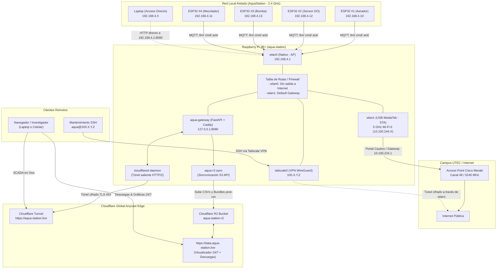

# Arquitectura de Red Dual: AquaStation

Este documento describe la arquitectura de red implementada en la Raspberry Pi 3B+ (`aqua-station`), combinando una red local aislada para microcontroladores ESP32 con acceso de alta velocidad a la red del campus (UTEC-Alumnos) y gestión remota segura.

---

## 1. Diagrama de Arquitectura



---

## 2. Tabla de Interfaces y Roles

| Interfaz | Hardware | Modo de Operación | Subred / IP | Rol Principal |
| :--- | :--- | :--- | :--- | :--- |
| **`wlan0`** | Broadcom BCM43455 (Nativo) | **AP (Hotspot)** `AquaStation` | `192.168.4.1/24` | Red local privada en 2.4 GHz para los ESP32. Sin salida a internet (aislada). |
| **`wlan1`** | MediaTek MT7961 (USB Externo) | **STA (Cliente)** `UTEC-Alumnos` | `10.100.244.X/19` | Conexión de alta velocidad en 5 GHz (Wi-Fi 6) al campus con puerta de enlace `10.100.224.1`. |
| **`tailscale0`** | Virtual (Software WireGuard) | **VPN Mesh** | `100.X.Y.Z` | Permite SSH directo y seguro desde tu laptop saltándose el aislamiento de clientes (AP Isolation) de UTEC. |

---

## 3. Características Clave

### A. Red Local Aislada (ESP32 $\rightarrow$ RPi)
- **SSID:** `AquaStation`
- **Contraseña:** `AquaPass`
- **Canal:** 2.4 GHz (Canal 6).
- **IP Fija de la RPi:** `192.168.4.1`
- **Seguridad:** Los ESP32 operan sin puerta de enlace (`gateway 0.0.0.0`) y con regla de bloqueo en firewall (`iptables -I FORWARD -i wlan0 -o wlan1 -j DROP`), asegurando que no se expongan a internet ni consuman ancho de banda externo.
- **Independencia:** Si el internet del campus se corta o vence el portal cautivo, la comunicación local entre sensores y la Raspberry Pi nunca se interrumpe.

### B. Salida a Internet (RPi $\rightarrow$ Campus)
- El adaptador USB MediaTek aprovecha la banda de **5 GHz en Wi-Fi 6 (802.11ax)** en el canal 48 con ~287 Mbps de tasa de transmisión y señal de -53 dBm.
- Se encarga de sincronización de reloj (NTP), actualizaciones del sistema operativo (`apt`) y subida de datos a servicios en la nube si es necesario.

### C. Métodos de Conexión y Acceso al Dashboard
1. **Directo por Wi-Fi Local:** Conectarse al AP `AquaStation` con contraseña `AquaPass` y acceder por web a `https://aqua-station.local` (o `ssh aqua@192.168.4.1`).
2. **Acceso Web Global (Cloudflare Tunnel):** Acceder a `https://aqua-station.live` desde cualquier lugar (laptop, teléfono o red externa). Utiliza un túnel saliente cifrado sobre HTTP/2 (puerto TCP 443) que evade las restricciones de firewall e inspección DPI de Fortinet.
3. **Mantenimiento Remoto (SSH):** Vía Tailscale cuando la red externa lo permita, o mediante SSH vía Cloudflare Access / Túnel local.

### D. Almacenamiento Persistente y Descargas 24/7 (Cloudflare R2 Edge)
1. **Portal Web y Visualizador:** Disponible en `https://data.aqua-station.live` (redirección automática a `/index.html`).
2. **Independencia de Hardware:** Servido por la red Anycast Edge de Cloudflare con 10 GB gratuitos permanentes y cero costo de transferencia de salida (*zero-egress fees*). Permite visualizar curvas de OD/RPM/Temp y descargar bundles completos aunque la Raspberry Pi esté apagada o fuera de servicio.
3. **Flujo de Sincronización Automática:**
   - **Post-Experimento Inmediato:** El orquestador (`engine.py`) detecta la transición a `completed`, genera los paquetes alineado y nativo, y lanza la subida a R2 en segundo plano.
   - **Cron Nocturno:** `aqua-flush.timer` corre a las 03:00 (hora local de Lima) para verificar y rotar telemetría diaria.
   - **Manual:** Comando de consola `aqua-r2-sync`.

---

## 4. Guía Práctica de Puesta en Marcha

### A. Configurar el Hotspot en la Raspberry Pi (Una sola vez)
Ejecuta estos comandos en la terminal de la Raspberry Pi:
```bash
# 1. Crear la red Wi-Fi AquaStation
sudo nmcli con add type wifi ifname wlan0 con-name "Hotspot-ESP32" autoconnect yes ssid "AquaStation"

# 2. Configurar modo Punto de Acceso (2.4 GHz, Canal 6, WPA2)
sudo nmcli con mod "Hotspot-ESP32" 802-11-wireless.mode ap 802-11-wireless.band bg 802-11-wireless.channel 6
sudo nmcli con mod "Hotspot-ESP32" wifi-sec.key-mgmt wpa-psk
sudo nmcli con mod "Hotspot-ESP32" wifi-sec.psk "AquaPass"

# 3. Definir IP estática de la RPi y modo compartido
sudo nmcli con mod "Hotspot-ESP32" ipv4.addresses "192.168.4.1/24"
sudo nmcli con mod "Hotspot-ESP32" ipv4.method shared

# 4. Activar el Hotspot
sudo nmcli con up "Hotspot-ESP32"

# 5. Bloquear salida a internet de los ESP32 (Aislamiento total)
sudo iptables -I FORWARD -i wlan0 -o wlan1 -j DROP
```

### B. Plantilla de Código para los ESP32 (Arduino / PlatformIO)
Cada ESP32 debe tener su propia IP fija dentro del rango `192.168.4.10` a `192.168.4.250`:

```cpp
#include <WiFi.h>

const char* ssid = "AquaStation";
const char* password = "AquaPass";

// Asignar IP fija única a cada ESP32 (ej. .10, .11, .12...)
IPAddress local_IP(192, 168, 4, 10);
IPAddress gateway(0, 0, 0, 0);          // Sin gateway = sin acceso ni salida a internet
IPAddress subnet(255, 255, 255, 0);

// Dirección IP fija del servidor en la Raspberry Pi
const char* rpi_host = "192.168.4.1";
const uint16_t rpi_port = 1883;         // Ejemplo: Broker MQTT (1883) o API HTTP (5000/8000)

void setup() {
  Serial.begin(115200);

  // Configurar IP estática antes de conectar
  WiFi.mode(WIFI_STA);
  WiFi.config(local_IP, gateway, subnet);
  WiFi.begin(ssid, password);

  Serial.print("Conectando al AP AquaStation");
  while (WiFi.status() != WL_CONNECTED) {
    delay(500);
    Serial.print(".");
  }

  Serial.println("\n[OK] Conectado exitosamente.");
  Serial.print("IP del ESP32: ");
  Serial.println(WiFi.localIP());
}

void loop() {
  // Lógica de envío de datos periódicos hacia rpi_host:rpi_port
}
```

### C. Comandos de Diagnóstico y Mantenimiento

- **Ver qué ESP32 están conectados físicamente al Hotspot:**
  ```bash
  iw dev wlan0 station dump
  ```
- **Ver las direcciones IP y MAC asociadas en la red local:**
  ```bash
  arp -a -i wlan0
  ```
- **Comprobar si un ESP32 específico responde:**
  ```bash
  ping -c 2 192.168.4.10
  ```
- **Reiniciar el Hotspot manualmente si fuera necesario:**
  ```bash
  sudo nmcli con down "Hotspot-ESP32" && sudo nmcli con up "Hotspot-ESP32"
  ```

