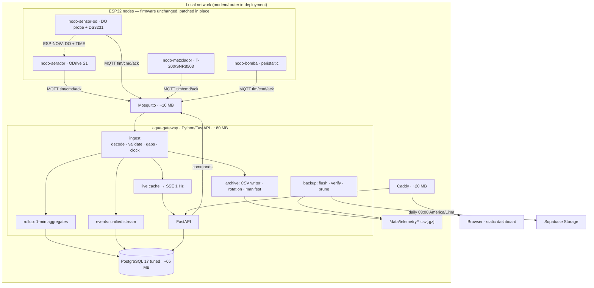

# Architecture

## 1. Context

Replacement for a **Next.js on Vercel + Supabase** deployment that exhausted Vercel's Hobby
allotment of **4 hours Active CPU per month** (estimated burn: ~17 CPU-hours).

Root causes, both structural rather than bugs:

| Cause | Evidence |
|---|---|
| Pull-based commands at 1 Hz, 24/7 | `COMMAND_POLL_INTERVAL_MS 1500` / `COMMAND_POLL_INTERVAL_MANUAL_MS 1000` — 2,400–3,600 req/h, **77% of aerator traffic**, almost all answering `has_command: false` |
| Work on every request | `deviceAuth.ts` ran SHA-256 **and** a `devices.upsert()` write per request |
| Browser fan-out | 4 endpoints every 4–15 s per open tab |
| Un-batched DB access | `/api/dashboard/summary` did ~10 sequential round trips |
| No cross-request state | Serverless re-created clients every invocation |
| Wrong platform shape | Constant always-on workload on scale-to-zero, CPU-metered compute |

The workload is ~0.5 rows/s. It was never large; it was simply deployed on a platform that charges
for being awake.

## 2. Component diagram

## 3. Data flow

**Ingest.** A node publishes a batch every 5 s. The gateway decodes and validates it against
`roles.yaml`, then fans out to **four** destinations — and only two touch persistent storage:

| Destination | Storage touched | Rate |
|---|---|---|
| Live cache | none (RAM) | every batch |
| SSE to browsers | none | 1 Hz |
| CSV buffer | block write on ~64 KB | ~58 writes/day |
| Rollup buffer | one INSERT | 1/minute/role |
| Event stream | one INSERT | on event |

Nothing writes per sample. The measured baseline is **~38,000 write ops/day while completely idle**
(rsyslog + journald `Storage=persistent`); the entire archive adds ~58. Fixing logging is therefore
worth ~650× more than anything we could do to the telemetry path — see `deploy/journald/`.

**Archive.** Per-role, per-day CSV, rotated and gzipped at midnight Lima time, tracked in a SQLite
manifest. See `docs/DATA-FORMAT.md`.

**Flush.** Daily at 03:00 Lima: upload unflushed files to Supabase Storage, verify sha256 and row
count on both ends, mark the manifest, then prune what is eligible.

**Export.** On demand or at experiment end, assemble the combined time-aligned wide dataset plus the
event overlay into a bundle. Derived, never stored at write time — see `docs/DATA-FORMAT.md` §6.

## 4. Why these choices

**MQTT instead of HTTP polling.** Not primarily for bandwidth — the data volume is similar. It
eliminates the *per-request fixed cost*: TLS handshake, HTTP framing, function invocation, SHA-256,
the per-request DB upsert, cold starts. Idle cost drops to one TCP keepalive per minute. It also
yields **Last Will & Testament** presence (replacing a 60 s heartbeat heuristic), **retained**
messages (a late subscriber sees current state), and **persistent sessions** (commands survive deep
sleep, with a deadline to prevent stale execution).

**Files for telemetry, tables for state.** A row costs ~200 B and dirties an 8 KB page; a CSV row
costs ~85 B appended sequentially. Telemetry is an immutable time-ordered log — the shape files were
designed for.

**Static dashboard on Caddy.** Every dashboard component is already `'use client'` and every call
uses a relative `/api/...` URL. Static export therefore costs **zero UI code changes** while removing
~150–250 MB of Node from a 905 MB machine. Caddy proxies `/api` and `/events` on the same origin, so
relative URLs keep working.

**Python over Node for the gateway.** Already installed on the Pi, ~60–90 MB vs Node's ~100–150 MB,
and it shares a language with the existing analysis tooling. No Node runtime needed on the Pi at all.

**PostgreSQL over TimescaleDB (for now).** With 5 Hz confined to 3-hour experiment windows, total
volume is ~28k rows/day at a 1-minute idle rate — about 880 MB/year raw CSV. TimescaleDB's
compression and chunk-drop retention solve a capacity problem that no longer exists. It can be added
later in place via `create_hypertable()`, so this is not a one-way door.

## 5. Resource budget (905 MB total)

| Component | Postgres | SQLite | Notes |
|---|---|---|---|
| OS + tailscaled + sshd | ~185 MB | ~185 MB | measured |
| Database | ~65 MB | ~10 MB | tuned; untuned Postgres would be ~200 MB |
| Gateway | ~80 MB | ~80 MB | Python + FastAPI |
| Mosquitto | ~10 MB | ~10 MB | |
| Caddy | ~20 MB | ~20 MB | |
| **Total** | **~360 MB** | **~305 MB** | **~545 MB headroom** |

SQLite remains a viable swap because the gateway is now the sole writer; the DB layer is isolated in
`gateway/aqua_gateway/db/` to keep that option open.

## 6. Ports and processes

| Process | Binds | Reachable from |
|---|---|---|
| `mosquitto` | 1883 | LAN (nodes) |
| `postgresql@17-main` | 5432 | loopback only |
| `aqua-gateway` | 8000 | loopback only |
| `caddy` | 80, 443 | LAN (browsers) |
| `tailscaled` | — | tailnet (remote admin) |

Caddy is the only LAN-facing surface for humans, so the dashboard's relative URLs work unchanged and
there is exactly one TLS terminator.

## 7. Build order

1. **Host prep** — expand rootfs (`sudo raspi-config --expand-rootfs`), set timezone
   `America/Lima`, silence idle logging, replace the PSU.
2. **Data tier** — PostgreSQL tuned, migrations applied.
3. **Protocol** — `docs/PROTOCOL.md` frozen; `roles.yaml` written.
4. **Gateway** — envelope/validation → archive → live/SSE → rollups → events → API.
5. **Web** — static export; polling replaced by SSE.
6. **Firmware patches** — apply per node, one node at a time, with HTTP paths still live as fallback.
7. **Backup** — flush, verify, prune, health.
8. **Cutover** — soak 72 h, then decommission Vercel.

## 8. Known constraints and risks

| Risk | Mitigation |
|---|---|
| Power quality — `throttled=0x50000` means under-voltage **has occurred**; this corrupts SD cards and can brown-out a running DB | Replace the PSU (5.1 V / 2.5 A). Consider a small UPS. |
| Generic white-label SD card (`SD32G`), endurance unverified | Aggressive write reduction (logging + no fsync). Nightly verified flush means the card is not the only copy. |
| Windows mobile hotspot used as the AP during development (`192.168.137.x`) | Dev-only; deployment uses a real modem/router. Reserve a static IP for the Pi either way. |
| `eth0` unused (`carrier=0`) — four nodes plus the Pi share one 2.4 GHz AP | Plug the Pi into Ethernet; removes contention and reduces jitter. |
| Pi has no RTC | DS3231 module (~$3); sensor RTC is the fallback authority. See `docs/TIME-SYNC.md`. |
| Rootfs half unallocated (~14.35 GiB) | `sudo raspi-config --expand-rootfs` — free space 9.7 GB → ~24 GB. |
