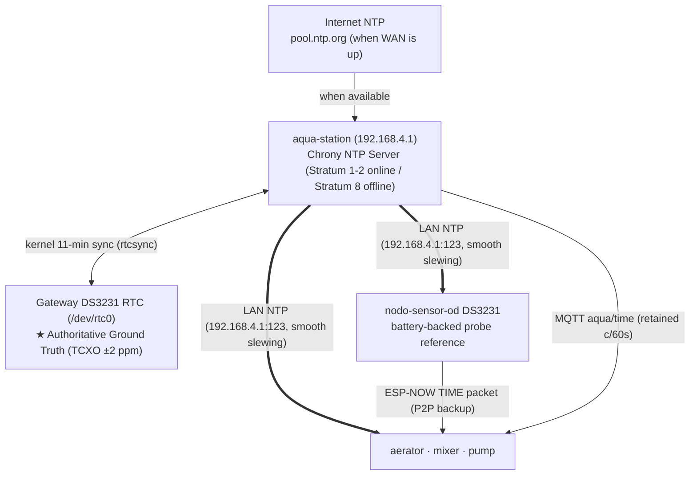

# Time synchronization

For a **combined multi-node dataset**, time alignment is a correctness requirement, not a nicety.
The analysis in `scripts/sysid_and_tune.m` and `advanced_thesis_tuning.m` identifies dynamics from
cross-correlations between DO, airflow and dosing. Unknown per-column time skew would quietly
invalidate exactly those results.

## 1. The problem & Hardware Foundation

- Each node has an independent clock.
- **The Raspberry Pi Gateway is fitted with a hardware DS3231 RTC (`/dev/rtc0` / I2C `0x68`)**:
  - TCXO crystal oscillator providing $\pm 2\text{ ppm}$ stability ($\approx 0.17\text{ s/day}$ drift).
  - Acts as the Authoritative Ground Truth across the entire bench.
  - Automatically synchronized with Internet NTP via Linux kernel 11-minute sync mode (`rtcsync`) when WAN is available.
- The nodes must keep working when the AP, the broker, or the internet is unavailable. Aeration
  control must not depend on network time.

## 2. Authority chain



| Tier | Source | Transport | Available when |
|---|---|---|---|
| 1 | Internet NTP via Chrony | WAN UDP 123 | Internet reachable |
| 2 | **Gateway DS3231 RTC via Chrony (`192.168.4.1`)** | LAN UDP 123 | Local WiFi up, WAN offline |
| 3 | **Sensor DS3231 over ESP-NOW** | Peer-to-peer radio | No WiFi, no Gateway — direct radio link |
| 4 | Gateway/Sensor DS3231 over MQTT (`aqua/time`) | MQTT topic `aqua/time` | Broker up |
| 5 | Node's own clock, `t_src = monotonic` | Internal timer | Everything else down; flagged in exports |

The Gateway operates Chrony with `allow 192.168.4.0/24`, serving NTP time to all microcontroller nodes in under 100 ms from boot. Nodes use `SNTP_SYNC_MODE_SMOOTH` to slew rather than step during active control loops.

## 3. Protocol

One timestamp, one meaning — **`t_dev_ms` is always Unix epoch milliseconds, UTC** — plus `t_src`
naming the clock that produced it (`ntp` | `espnow` | `rtc` | `monotonic`).

This retires the previous ambiguity where `rtc_timestamp_ms` could mean epoch ms *or* ms since
2000-01-01, disambiguated by a magic threshold. Guessing is not a protocol.

`aqua/time` (retained, QoS 1):
```json
{ "t_dev_ms": 1791548030000, "t_src": "ntp", "uncertainty_ms": 5 }
```

ESP-NOW `TIME` packet carries the identical payload.

## 4. Offset measurement and correction

The gateway records, for every message, both:

- `t_dev_ms` — what the node believed
- `t_arr` — when the gateway received it

It maintains a per-`(node_id, boot_id)` estimate of:

- **offset** — the signed difference between node clock and gateway clock
- **drift rate** — offset change per hour, via linear fit over a sliding window
- **uncertainty** — spread of recent residuals

Estimation is only meaningful on **idle traffic**, because transit jitter during a burst inflates
residuals. So offsets are computed from heartbeats and idle batches, and *applied* to experiment
windows.

| Condition | Event |
|---|---|
| offset above threshold on first sync | `clock_resynced` |
| offset drifts beyond threshold mid-run | `clock_offset_exceeded` *(warning)* |
| uncertainty above threshold | `clock_uncertainty_high` |
| `t_src = monotonic` on experiment data | flagged in bundle manifest |

**Raw archive data is never rewritten.** `t_dev_ms` is stored exactly as the node reported it, and
correction is applied at **export** time. This keeps the archive an honest record of what the node
believed, while exports carry the corrected view *and* the correction that was applied.

## 5. What the export records

`manifest.json` in each experiment bundle captures, per node:

- measured offset applied, and its uncertainty
- drift rate over the window
- `t_src` history (did it change mid-experiment?)
- count of samples flagged uncertain

Without this, an aligned dataset cannot be audited after the fact — and a suspicious result could
not be distinguished from a clock artefact.

## 6. Node-side requirements

- SNTP sync at boot when the LAN is reachable; fall back to ESP-NOW, then to the local RTC.
- Accept and apply ESP-NOW `TIME` packets at any time, but **rate-limit** application so a spurious
  packet cannot step the clock under a running control loop. Prefer slewing over stepping during a
  PID cycle.
- **Never** let a time update jump the clock backwards mid-experiment; record the correction and
  keep `seq` monotonic regardless.
- Persist the last known good offset so a rebooted node starts approximately aligned.
