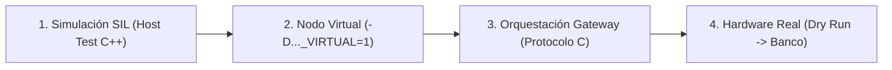

# Guía de Incorporación y Validación de Controladores en AquaControl

Esta guía detalla la metodología estandarizada para diseñar, implementar, probar y validar cualquier algoritmo de control (PID, Fuzzy, MPC, Modo Deslizante, etc.) dentro del ecosistema **AquaControl**.

---

## 1. Arquitectura de Control y Restricciones Físicas

### Dinámica Asimétrica del Proceso de OD (Oxígeno Disuelto)
En un banco de pruebas de agua limpia (Clean-Water Bench según estándar ASCE/EWRI 2-22):
- **Respiración biológica nula ($R_{bio} = 0$):** No existen peces ni bacterias que consuman oxígeno pasivamente.
- **Autoridad de control unidireccional:** El actuador (ODrive S1 + aireador) solo puede inyectar oxígeno ($+dC/dt$). A 0 RPM, la reaeración superficial natural mantiene la derivada no negativa ($dC/dt \ge 0$).
- **Sobreimpulso catastrófico ($M_p = 0.0\%$):** Cualquier sobreimpulso más allá del setpoint ($SP$) arruina el ensayo de forma irreversible, obligando a desoxigenar químicamente el estanque nuevamente con sulfito de sodio ($Na_2SO_3$).
- **Retardos de transporte e instrumentación:**
  - Retardo dinámico de la sonda óptica OPTOD ($T_{90} \approx 30\text{--}60\text{ s} \implies \tau_s \approx 20\text{ s}$).
  - Tiempo de residencia y flotabilidad de microburbujas ($\tau_{\text{bubble}} \approx 15\text{--}30\text{ s}$).

```
                             Zona de Sobreimpulso (FALLO IRREVERSIBLE)
     DO                     ┌──────────────────────────────────────────────┐
      ▲                     │  Reaeración superficial natural IMPIDE caída │
   SP ┼─ ─ ─ ─ ─ ─ ─ ─ ─ ─ ─│─ ─ ─ ─ ─ ─ ─ ─ ─ ─ ─ ─ ─ ─ ─ ─ ─ ─ ─ ─ ─ ─ ─ │
      │                    /│\  Motor a 0 RPM no puede sustraer oxígeno    │
      │                   / └──────────────────────────────────────────────┘
      │                  /
      │                 /   Trayectoria estrictamente monótona
      │                /    (Amortiguamiento crítico / sobreamortiguado)
    0 ┴───────────────┴────────────────────────────────────────► Tiempo
```

---

## 2. Abstracción del Algoritmo (Capa Firmware)

El algoritmo debe aislarse completamente del hardware en una clase pura en C++ o dentro de `ControlEngine` (`nodo-aerador/src/control_engine.cpp`).

### 2.1 Principios de Implementación
1. **Paso de tiempo explícito (`dt`):** Calcular derivadas e integrales a partir de `dt = (nowMs - lastMs) / 1000.0f` para garantizar determinismo y reproducibilidad tanto en el microcontrolador como en pruebas SIL.
2. **Anti-Windup Condicional (Tracking / Clamping):** 
   - Congelar la integral mientras el error sea grande ($|e| > \text{int\_band}$, e.g. $0.8\text{ mg/L}$).
   - Resetear o descargar la integral inmediatamente si $e < 0$ (cruce por encima de consigna).
3. **Derivada sobre la medición (Derivative on PV):** 
   - Calcular $D = -K_d \frac{d(PV)}{dt}$ para evitar el "derivative kick" ante cambios escalón en el setpoint.
4. **Horizonte de Frenado Predictivo (Coasting Horizon):**
   $$C_{\text{pred}}(t) = C_{\text{meas}}(t) + (\tau_s + \tau_{\text{bubble}}) \cdot \frac{dC_{\text{meas}}}{dt}$$
   Si $C_{\text{pred}}(t) \ge SP$, desacelerar inmediatamente a 0 RPM antes del cruce físico.

---

## 3. Flujo de Validación en Cuatro Pasos



### Paso 1: Pruebas SIL en PC (Host Testing)
Compilar la lógica de control con `g++` contra un modelo simulado sin necesidad de placas físicas:
- Archivo de referencia: `nodo-aerador/test/test_control_engine.cpp`.
- Comprobar:
  - Salto de consigna (0 a 6 mg/L).
  - Comportamiento de saturación $[0, 600\text{ RPM}]$.
  - Prioridad absoluta del `Emergency Stop` (corte instantáneo a 0 RPM).
  - Timeout de failsafe ante desconexión de sonda (retorno a velocidad segura).

### Paso 2: Validación con Nodos Virtuales
Cada nodo posee un bus inyectado (`IMotorBus` o `IPumpBus`):
- `src/<node>_bus_real.cpp`: Controla hardware real (UART ODrive, PWM, I2C).
- `src/<node>_bus_virtual.cpp`: Emula el comportamiento del motor y sensores contra el modelo físico (`src/<node>_sim.cpp`).
- Probar con:
  ```bash
  cd aqua-station/firmware/virtual_node
  python3 check_closed_loop.py
  ```

### Paso 3: Orquestación en el Gateway (`aqua-station`)
Integrar el protocolo de ensayo en `aqua-station/gateway/aqua_gateway/orchestration/recipes.py`:
1. Definir una fase de configuración que envíe `target_do`, `kp`, `ki`, `mode`.
2. Definir una fase activa con condición de parada (`elapsed` o `do_above`).
3. Enviar comandos por MQTT `cmd/aerator` y verificar los ACKs y telemetría `tlm/aerator`.

### Paso 4: Ensayo en Hardware Físico
1. **Dry Run (Prueba en vacío):** Verificar que el ODrive S1 responda correctamente al comando de velocidad sin acoplamiento de fluido.
2. **Protocolo A (Desoxigenación previa):** Utilizar `nodo-bomba` para inyectar sulfito ($Na_2SO_3$) y llevar el OD basal a $C_0 \approx 1.5\text{--}2.5\text{ mg/L}$.
3. **Protocolo C (Lazo Cerrado Activo):** Ejecutar el lazo y validar mediante el CSV exportado (`/data/telemetry/EXP_03_PID_LOOP.CSV`):
   - Sobreimpulso máximo ($M_p \le 0\%$).
   - Tiempo de subida ($t_r$).
   - Error en régimen permanente ($e_{ss} \le \pm 0.1\text{ mg/L}$).
   - Esfuerzo de control y suavidad en corriente $I_q$ y RPM.

