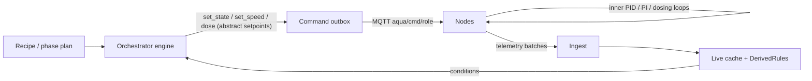

# Workstream 1 — Gateway Orchestrator Engine

> Part of the AquaSCADA Lab refactor. Companion plans:
> `plan-ws2-lifecycle.prompt.md` (run lifecycle + milestones), `plan-ws3-ui.prompt.md` (UI/UX).

## Rung decisions

- **Global state machine**: rung 2 — `system_settings.system_state` JSONB already exists
  (`migrations/001_core.sql` line 73) seeded with `IDLE`. Reuse it. No new table.
- **Per-phase state**: rung 7 — nothing backs phased recipes today. One table (WS2 owns it).
- **Recipe definitions**: rung 7, but **declarative data** (a dict), not logic.
- **Actuator changes**: rung 2 — every phase action goes through the existing
  `commands.issue()` outbox. The orchestrator is a *client* of the outbox, not a second
  command path. This is the single most important constraint in this plan.
- **Condition evaluation**: rung 2 — the `DerivedRules` engine already computes DO, trend,
  temp and latches. The orchestrator subscribes to the same live cache rather than
  re-deriving thresholds.

## Confirmed architecture (owner's decision)

The **gateway is the master orchestrator**: it holds the recipe, decides when a phase's
physical condition is met, and issues abstract setpoints/commands. The **nodes are inner-loop
controllers**: they obey an outer command (`set_state {state:"ACTIVE_EXPERIMENT"}`,
`set_speed {speed_percent:40}`) and use their own firmware loops (ODrive 20 Hz PID, T-200 PI
at 100 Hz, pump encoder) to *satisfy* it. The gateway never streams per-sample setpoints.
This is already the documented model in `docs/ARCHITECTURE.md` §4 ("the PID loops run on the
nodes; this is supervisory") — the orchestrator formalises the *sequencing* layer on top.

## Files to touch

| File | Change |
|---|---|
| `gateway/aqua_gateway/orchestration/__init__.py` | New package. Exports `Orchestrator`. |
| `gateway/aqua_gateway/orchestration/recipes.py` | New. Declarative `PROTOCOLS` dict: three recipes (`planta_1_deox`, `planta_2_step`, `closed_loop`), each a list of phases with `id/num/title/params/condition/mode`. Port of the mockup's `PROTOCOLS` object. |
| `gateway/aqua_gateway/orchestration/engine.py` | New. State machine + phase advancement + condition evaluation. Issues commands via `Gateway.commands.issue()`. |
| `gateway/aqua_gateway/orchestration/conditions.py` | New. Small pure predicates over a `LiveSnapshot` + `DerivedRules` state (`do_below`, `do_stable`, `timeout`, `reached_setpoint`). Pure → testable. |
| `gateway/aqua_gateway/api/app.py` | Add `POST /api/state` (revives `StateRequest`, line 52), `GET /api/state`, `GET /api/recipes`. |
| `gateway/aqua_gateway/main.py` | Instantiate `Orchestrator` alongside `gateway.derived`; feed it live frames. |
| `gateway/tests/test_orchestration.py` | New. State-machine + condition + phase-advance assertions. |

## Design detail

### Global state machine (reuses `StateRequest`)

`StateRequest` fields already match what is needed (`state`, `experiment_id`, `requested_by`).
Valid states: `IDLE | ACTIVE_EXPERIMENT | MANUAL_OVERRIDE`. Transitions:

| From | To | Guard |
|---|---|---|
| IDLE | ACTIVE_EXPERIMENT | a valid `experiment_id` exists and is `planned`/`paused` |
| ACTIVE_EXPERIMENT | MANUAL_OVERRIDE | operator request; orchestrator suspends phase advancement |
| ACTIVE_EXPERIMENT | IDLE | experiment `completed`/`aborted` |
| MANUAL_OVERRIDE | ACTIVE_EXPERIMENT | operator request; resume from current phase |
| any | IDLE | E-STOP latched (`emergency_stop` event) |

`POST /api/state` writes `system_settings.system_state` (JSONB) and emits a
`STATE_CHANGE` event (already in `events/model.py` line 218, scope SYSTEM).

### Phase advancement

The engine ticks on each live frame (or a 1 Hz timer). For the active phase it evaluates
`condition`. On satisfaction:
1. emit `EXPERIMENT_PHASE_CHANGE` (already exists, line 68);
2. issue the *next* phase's commands through the outbox (superseding the previous setpoints
   atomically — which is exactly why the outbox's `SUPERSEDING_ACTIONS` exists);
3. advance the per-phase row (WS2 table).

Mode semantics (from the mockup, confirmed):
- `AUTO` — apply consignas and advance on the physical condition, no operator input.
- `HIBRIDO` — apply consignas; when the condition is met, **wait** for an operator confirm
  before advancing.
- `MANUAL` — the operator fires each action; the condition is advisory only.

### Condition predicates (`conditions.py`)

Pure functions returning `bool`, fed by `LiveSnapshot` and `DerivedRules` levels:

- `do_below(threshold)` / `do_above(threshold)`
- `do_stable(window_s, eps_mg_l)` — reuses the least-squares trend logic already validated in
  `events/derived.py::_do_trend` (do **not** re-implement; factor the slope helper out and share it).
- `setpoint_reached(role, field, target, tol)` — reads the node's own measured value.
- `elapsed_ge(seconds)` — wall-clock timeout, always OR-ed with a safe fallback so a phase can
  never deadlock.

Every condition is paired with a mandatory timeout. A phase with no timeout is rejected at
recipe-load time (assert in `recipes.py`) — this is the deadlock guard.

### kLa — explicitly out of scope

Per owner: saturation is empirically ~7.15 mg/L and **no kLa estimation is needed**. The
orchestrator does **not** compute kLa, and `KLA_DEGRADATION_SUSPECTED` (already in
`events/model.py` line 132) stays unused for now. The recipe's `p2_step` phase merely records
the step and the DO curve; `C*` is a displayed constant (WS3), not a derived quantity.

## Verification

- `pytest tests/ -q` — existing 265 stay green.
- New `test_orchestration.py`:
  - IDLE→ACTIVE→MANUAL→ACTIVE round-trip updates `system_state` and emits `STATE_CHANGE`.
  - A 3-phase recipe advances when conditions are fed in order; each advance issues exactly
    one command set through the outbox (assert on a fake publisher).
  - A phase whose condition never fires advances via its timeout (deadlock guard).
  - Every recipe in `PROTOCOLS` declares a timeout per phase (load-time assertion).
  - HIBRIDO mode does **not** advance until `confirm_phase` is called.

## Status — IMPLEMENTED (2026-10-10)

Files created:
- `gateway/aqua_gateway/orchestration/{__init__,recipes,conditions,engine}.py`
- `gateway/migrations/005_orchestration.sql` (`experiment_phases`)
- `gateway/tests/test_orchestration.py` (22 tests)

Files edited:
- `api/app.py` — `GET/POST /api/state`, `POST /api/state/confirm`, `POST /api/state/phase-mode`,
  `GET /api/recipes`; revives `StateRequest`. Imports `RECIPES`.
- `main.py` — constructs + starts/stops `Orchestrator`, passes it to `MqttIngest`.
- `mqtt/client.py` — optional `orchestrator`, forwards each `od_sensor` sample via `observe()`.
- `events/derived.py` — `_do_trend` now delegates to the shared
  `orchestration.conditions.least_squares_rate_per_min`.

Verified: `306 passed` (284 pre-existing + 22 new); ruff clean on all new files; routes
register on the app; no circular imports (`orchestration/__init__.py` deliberately does not
re-export the engine, so `events.derived` → `orchestration.conditions` is a leaf import).

Note: the engine is tested with hand-written fakes (no live Postgres), matching the existing
`test_commands.py` pattern.

## Risks / open questions

- **Tick source**: engine can tick on live frames or a 1 Hz task. Recommendation: live frames
  (already arriving) with a 1 Hz watchdog for timeouts. Confirm tick cadence is acceptable.
- **Supersession ordering**: a phase that issues `set_state` while a manual `set_speed` is
  pending will supersede it by design. Verified against `outbox.SUPERSEDING_ACTIONS`; called
  out here so it is not a surprise in the field.
- **`closed_loop` recipe** implies the orchestrator monitors a SP and tunes gains. Since nodes
  own the loop, the gateway only sends the SP + gains once (`set_config`) and watches `e(t)`.
  No per-sample participation.
- **MANUAL_OVERRIDE interaction with recipes**: the mockup's per-phase MANUAL mode is *inside*
  a running experiment, whereas `MANUAL_OVERRIDE` is a *global* state. Two axes can coexist;
  flagged so the UI does not conflate them.
